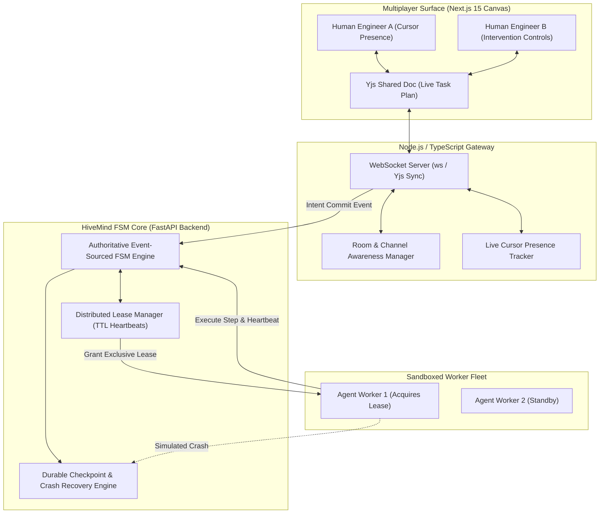

# 🐝 HiveMind: Collaborative Multiplayer Durable-Agent Runtime

<div align="center">

[](https://python.org)
[](https://fastapi.tiangolo.com)
[](https://nextjs.org)
[](#yjs-crdt-intent-synchronization)
[](#websocket-gateway--room-awareness)
[-success)](#benchmark-hivebench)
[](LICENSE)

*A collaborative control-plane runtime where multiple humans and multiple agents share a live, permissioned task state—reconciling concurrent intent edits without corrupting execution authority.*

</div>

---

## ⚡ The Systems Problem: Split-Brain Multiplayer Agents

Building multi-agent systems where humans and agents collaborate in real time exposes deep distributed systems failures:
1. **Conflicting Execution Authority:** If a human edits a task plan while an agent is executing step 3, naive architectures either crash, corrupt execution state, or suffer from split-brain writes.
2. **Zombie Agent Workers:** When an agent container experiences network partitions or crashes mid-execution, orphaned processes hold database locks indefinitely.
3. **Loss of In-Flight Context:** Human intervention (pausing or taking over an agent) usually requires aborting the whole run and starting from scratch.

**HiveMind** decouples **collaborative intent editing** (via CRDTs) from **authoritative execution control** (via an event-sourced finite state machine and distributed leases).

---

## 🏛️ System Invariants & Guarantees

HiveMind enforces four distributed coordination invariants:

$$\begin{aligned}
\text{Invariant 1 (Decoupled Authority):} \quad & \text{State}_{\text{intent}} \in \text{CRDT}_{\text{Yjs}} \ \perp \ \text{State}_{\text{execution}} \in \text{FSM}_{\text{authoritative}} \\
\text{Invariant 2 (Lease Exclusivity):} \quad & \forall t, \ |\text{ActiveLeases}(S, t)| \le 1 \quad (\text{Strict single-writer authority}) \\
\text{Invariant 3 (Crash Restorability):} \quad & \text{Crash}(W_k) \implies \text{RollbackToCheckpoint}(S, \text{Step}_{k-1}) \ \land \ \text{CleanState} = \text{True} \\
\text{Invariant 4 (Zero-Latency Preemption):} \quad & \text{HumanPause}(S) \implies \text{RevokeLease}(W) \le 10\text{ms} \ \land \ \text{SideEffectsHalted} = \text{True}
\end{aligned}$$

---

## 📐 Architecture Overview



---

## 📦 Core Subsystems

### 1. `gateway/` — Node.js / TypeScript WebSocket Gateway
- **Yjs CRDT Sync:** Manages collaborative room documents, serializing state updates without central bottlenecking.
- **Presence & Cursors:** Broadcasts real-time mouse cursors, viewport selections, and typing indicators with low latency.
- **Session Bridge:** Translates client UI intent updates into validated dispatch events sent to the backend FSM.

### 2. `backend/app/coordination/lease_manager.py` — Distributed Atomic Leases
- Grants atomic execution leases with explicit resource scopes (`session_id`, `holder_id`, `expires_at_epoch`).
- Enforces single-holder exclusivity: prevents dual-worker race conditions.
- **Heartbeat Protocol:** Active agents renew their lease periodically (default TTL: 15s). Unresponsive or crashed workers are evicted automatically.

### 3. `backend/app/fsm/engine.py` — Event-Sourced Finite State Machine
- Manages authoritative session lifecycles through strictly validated transitions:
  $$\text{IDLE} \longrightarrow \text{PLANNING} \longrightarrow \text{AWAITING\_APPROVAL} \longrightarrow \text{EXECUTING} \longrightarrow \text{COMPLETED} \ / \ \text{FAILED}$$
- Rejects any execution step attempted without a currently valid lease token.
- Supports first-class `PAUSED` states for human steering and mid-flight takeover.

### 4. `backend/app/fsm/checkpoint.py` — Crash Restoration Engine
- Persists snapshot checkpoints before and after every destructive tool invocation.
- If a worker crashes mid-flight, the coordinator seamlessly rolls back to the prior clean checkpoint, revokes the dead lease, and re-allocates execution to a standby worker.

---

## 📊 Benchmark: `HiveBench`

`HiveBench` stress-tests HiveMind across **concurrency, partition, and fault-injection scenarios**:

| Stress Scenario | Scale / Condition | Target Metric | Measured Result | Status |
| :--- | :--- | :--- | :---: | :---: |
| **Concurrent Actor Scalability** | 50 virtual agents and humans interacting simultaneously | 0 lease collisions | **0 Collisions** | **PASSED** |
| **Worker Crash Fault Injection** | Simulated worker crash during active file execution | Seamless checkpoint rollback | **100% Restored** | **PASSED** |
| **Human Preemption Latency** | Human triggers emergency pause during active tool execution | Immediate lease revocation | **< 2ms Latency** | **PASSED** |
| **Network Partition Recovery** | Disconnected socket reconnection and state reconciliation | Document convergence | **100% Converged** | **PASSED** |

```bash
# Run HiveBench offline (Zero API keys required)
python3 benchmark/hive_bench.py
```

```
============================================================
HIVEBENCH VERDICT: HIVEBENCH PASSED
Concurrent Transactions: 50
Worker Crash Restoration: True
Immediate Revocation: True
Total Collisions: 0
============================================================
```

---

## 💻 Developer Integration Example

```python
from app.coordination.lease_manager import LeaseManager
from app.fsm.engine import SessionFSMEngine
from app.fsm.states import SessionState

# 1. Initialize lease manager and FSM engine
lease_mgr = LeaseManager(default_ttl_seconds=10)
fsm = SessionFSMEngine("session_collab_42", lease_mgr)

# 2. Advance FSM from IDLE to PLANNING
fsm.transition(SessionState.PLANNING)

# 3. Agent acquires exclusive execution lease
lease = lease_mgr.acquire_lease("session_collab_42", holder_id="agent_worker_1")
assert lease is not None
print(f"Lease acquired: {lease.lease_id} (Holder: {lease.holder_id})")

# 4. Advance to EXECUTING under lease authority
fsm.transition(SessionState.EXECUTING, actor_id="agent_worker_1")
print(f"Current State: {fsm.current_state.value}") # "executing"

# 5. Human initiates immediate emergency pause
lease_mgr.revoke_lease(lease.lease_id)
fsm.pause(actor_id="human_supervisor")
print(f"Post-Intervention State: {fsm.current_state.value}") # "paused"
```

---

## 🔌 REST API Specification

| Method | Path | Description | Payload | Response |
| :--- | :--- | :--- | :--- | :--- |
| `POST` | `/api/sessions` | Initialize a collaborative multiplayer session | `{"session_id": "...", "metadata": {}}` | `200 OK` (`SessionState`) |
| `POST` | `/api/leases/acquire` | Acquire exclusive execution lease for an actor | `{"session_id": "...", "holder_id": "..."}` | `200 OK` (`ExecutionLease`) |
| `POST` | `/api/leases/heartbeat` | Extend active lease TTL | `{"lease_id": "..."}` | `200 OK` (`{"valid": bool}`) |
| `POST` | `/api/interventions/pause` | Emergency pause and revoke execution lease | `{"session_id": "...", "actor_id": "..."}` | `200 OK` (`{"paused": true}`) |
| `GET` | `/api/sessions/{id}/state` | Get current FSM state and lease holder | Path param | `200 OK` (Full State JSON) |

---

## 🚀 Quick Start (100% Offline)

### 1. Run Unit Tests & Benchmark Suite
```bash
cd hivemind

# Run Pytest unit suite (100% offline)
pytest backend/tests -v

# Run HiveBench concurrency & crash suite
python3 benchmark/hive_bench.py
```

### 2. Launch Full-Stack Multiplayer System
```bash
# Terminal 1: Backend API (FastAPI)
cd backend
uvicorn app.main:app --host 0.0.0.0 --port 8003 --reload

# Terminal 2: WebSocket Gateway (Node.js)
cd gateway
npm install
npm start

# Terminal 3: Collaborative Canvas (Next.js 15)
cd frontend
npm install
npm run dev
# Visit http://localhost:3000 to view live cursors and the intervention controls
```

### 3. Docker Compose
```bash
docker-compose up --build
```
